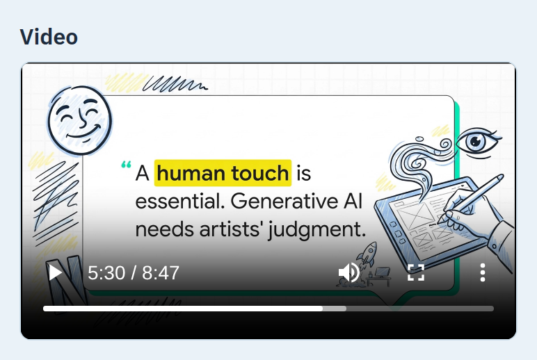
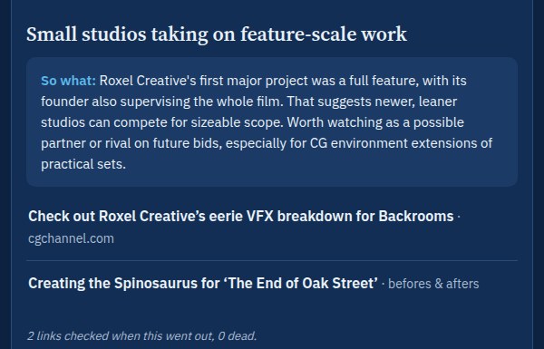

<!-- features -->
### More for your customers every morning than you could make by hand
Every issue gives your customers the news with the meaning attached: what changed, why it matters to them, and the original link, checked before the issue goes out.

Up to twice a week LongLens adds an extra on top: an audio overview first, then a slide deck or a short explainer video. The plumber listens in the van. The office manager reads on the train. You could not make this by hand. Now you do not have to.

Pick the one that leads your own email: read it, skim it, listen, watch or flip the slides, and your copy arrives with it on top. LongLens crafts each piece once, however many customers you have.

Real explainer video from one issue of a daily VFX update, as it plays on the issue page.

### Noticed by the right people
Send your issue on through the email tool you already use, or simply forward it, and your name and your issue number are in front of your customers every morning.

Week after week they see who knew first. Issue #41 is the proof you were right in issue #12.

Coming: LongLens sends straight to each customer, and each one picks the form they already use: the audio for the one in the van, the two-minute version for the skimmer, the slides for the one who runs the Monday meeting.

### The one they trust to know what's happening, and what it means
Over a month of mornings, you become the one the customer with a question asks first, because your issue told them first and told them why.

Most stories carry one line on why they matter to your customers, so the issue is never a link dump. A story they have already seen stays out until something changes, then comes back marked as an update. LongLens tries every link before the issue goes out, and the last line of every issue shows your readers how many were checked and how many were dead.

Real web issue, last lines.

### Sounds like you, because you taught LongLens
"Shorter." "More on the new rules, less on trade shows." "Drop that site, add this one." Reply to any issue in your own words and the next one changes. You get a note back saying what LongLens understood, and replying UNDO takes it back. LongLens gets you a little more every week.

Every reply changes the next issue, and the ones after it.

### Forward the newsletters you never open. Get what matters tomorrow.
Forward LongLens the newsletter you never open, or save a page from your phone or your browser, and LongLens puts what matters in your next issue under "You sent".

No customers needed for this part. Start as the reader, and send your issue on when you are ready.
<!-- /features -->

<!-- who -->
### A local trade
A plumber, an electrician, a builder. New rules, prices and kit, explained by the person who will fit it. Your customers hear it from you first, and remember who told them.

### Advisers and consultancies
You are paid for knowing. Send your issue on and your clients get a taste of it every week, under your name, and a reply turns into a conversation.

### Trade bodies and brands
Send one issue to the whole field, and everyone hears what changed from one source it trusts, with a person's name on every issue.
<!-- /who -->

<!-- notfor -->
### Write your own company news
LongLens works from what the trade press, the forums and the videos say about your trade. Your own announcements are still yours to write.

### Run ads or paid subscriptions
Use a newsletter platform built for that.

### Replace you
Your judgment is the point. LongLens makes it reach further, every morning.
<!-- /notfor -->

<!-- compare -->
### By hand
Read the trade press every morning and write it up yourself. Full control. It costs the hours you do not have, and it dies the first busy week.

### A newsletter platform
Great at sending and at growing a list. No idea what to say. You still find the news and write every word.

### A personal AI summary
Fast, often free, and fine for keeping yourself informed. It is written for you. Nobody else reads it, nobody learns what you know, and your name is nowhere on it.
<!-- /compare -->

<!-- faq -->
### How do we start, and how does it reach my customers?
A short call, then I point LongLens at the websites, forums, videos and newsletters you trust, and we describe your customers in your words. You see a week of real issues before anyone else does. Today each issue comes to you first, and you send it through the email tool you already use, or forward it. Email straight to your customers from your own address is coming.

### Does LongLens make a separate video for every customer?
No. LongLens crafts each piece once per issue, whether ten people read it or ten thousand. So when each customer picks their own format (coming), the cost still does not grow with your list.

### Is AI writing it?
Yes. LongLens writes with AI, checks names and figures against the original story, tries every link before the issue goes out, and you change anything by replying. Your name is on it, so the last word is yours.

### Who owns what LongLens makes?
You do. Every issue, every website you chose, every lesson you taught LongLens.
<!-- /faq -->

<!-- plans -->
### Free :: $0
Know what changed in your trade before your first coffee.

- Your letter every morning, to read
- Audio every morning, read in a plain voice
- Coming: the full audio conversation every morning
- Coming: a weekly summary as a letter, audio and video

[Get my free invite](mailto:geoff@thevfxsupervisor.com?subject=LongLens%20Free%20invite)

### Solo :: $19 a month
Your trade's news every morning, plus video to watch and slides to flip through, up to twice a week.

- Your letter and a plain-voice audio read every morning
- The full audio conversation, video and slides, up to two a week
- Coming: the full audio conversation, video and slides every morning
- Coming: the whole issue as one picture

[Get my Solo invite](mailto:geoff@thevfxsupervisor.com?subject=LongLens%20Solo%20invite)

### Business :: $95 a month
Be the expert your customers hear from first.

- Everything in Solo, under your name, for your customers
- Set up with you on one short call
- Send each issue through the email tool you already use, or forward it
- Each issue posted to your Slack or Discord channel
- Your own blog page: you choose which issues go up
- Coming: LongLens sends straight to your audience from your own address
- Coming: social posts for every issue
- Coming: your issue on Telegram

[Put my name in front of my customers](#inquiry)
<!-- /plans -->

<!-- coming -->
### Email straight to your customers
Issues sent from your own address (for example news@yourbusiness.com), each customer in the format they picked, with a dated record of each customer's yes and one-click unsubscribe.

### The one picture
The whole issue on one screen, for the person who will not read.

### Sign up on your own
Today we set it up with you.
<!-- /coming -->
